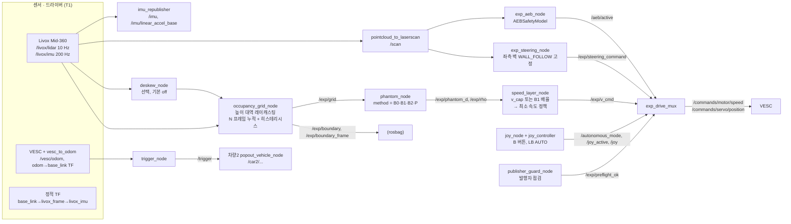

# 구조

관측 공백 속도 계획 실험(exp 모드)과 기존 주행(drive 모드)의 노드 구성. 실행 절차는 [RUNBOOK.md](RUNBOOK.md),
세션별 명령은 [SESSIONS.md](SESSIONS.md). 대상 플랫폼: **ROS2 Foxy, Ubuntu 20.04, Python 3.8** (차량 Jetson 두 대).

## 1. 설계 원칙

- **네 방법(B0/B1/B2/P)은 phantom 배치 규칙만 다르다.** 점유격자, v_cap 식, 최소 속도 정책, AEB, 조향, 최종 명령은
  한 벌의 노드와 한 파일(`config/common.yaml`)을 공유하고, 방법은 `phantom_node`와 `speed_layer_node`의 `method`
  파라미터 하나로만 갈린다 (`my_algo/phantom.py`의 전략 클래스). 결과 차이를 배치 규칙의 효과로 해석하기 위해서다.
- **drive 모드는 바꾸지 않는다.** exp 모드는 새 노드로만 만들고, 기존 planner는 상속으로만 조향을 바꾼다.
  리팩터링 전후 drive 명령 동일성은 `scripts/verify_refactor*.py`로 확인한다 (기준선 태그 `baseline-pre-refactor`).
- **순수 로직은 ROS와 분리한다.** 격자, 경계, phantom 전략, v_cap, 최소 속도 정책, 지표, deskew, 발행자 점검 규칙은
  `my_algo/*.py` 순수 모듈이고 `test/`에 단위 테스트가 있다. 노드는 메시지 변환과 시간 관리만 한다.

## 2. exp 모드 파이프라인



최종 명령(`exp_drive_mux`) 우선순위: 조이스틱 B·AUTO 해제 > 발행자 점검 > 조이스틱 끊김(0.5 s) > 소프트웨어 정지선 >
AEB(회차 끝까지 래치) > 입력 끊김 > 정상(속도 = `/exp/v_cmd`, 조향 = `/exp/steering_command`).

## 3. 노드 표

| 노드 | 역할 | 입력 | 출력 | 파일 |
|---|---|---|---|---|
| imu_republisher | IMU 단위·바이어스·중력 보정 (분석 전용) | `/livox/imu` TBD(세션 1) | `/imu`, `/imu/linear_accel_base`, `/imu/status` | [my_algo/imu_republisher.py](../my_algo/imu_republisher.py) |
| pointcloud_to_laserscan | 점군 → 2D scan (drive와 같은 값) | 점군 | `/scan` | 외부 패키지, [config/common.yaml](../config/common.yaml) |
| deskew_node | 프레임 내 이동 보정 (선택) | 점군, TF | `/exp/cloud_deskewed` | [my_algo/deskew_node.py](../my_algo/deskew_node.py) |
| occupancy_grid_node | 높이 대역 레이캐스팅 격자, 가림 경계 | 점군, TF | `/exp/grid`, `/exp/boundary`, `/exp/boundary_frame`, `/exp/grid_debug` | [my_algo/occupancy_grid_node.py](../my_algo/occupancy_grid_node.py) |
| phantom_node | 방법별 phantom 배치, d, ρ | `/exp/grid`, TF | `/exp/phantom_d`, `/exp/rho`, `/exp/phantoms`, `/exp/phantom_debug` | [my_algo/phantom_node.py](../my_algo/phantom_node.py) |
| speed_layer_node | v_cap·B1 + 최소 속도 정책 | d, ρ | `/exp/v_cap`, `/exp/v_raw`, `/exp/v_cmd`, `/exp/min_speed_flag` | [my_algo/speed_layer_node.py](../my_algo/speed_layer_node.py) |
| exp_aeb_node | AEB (drive와 같은 모델·임계값, 앞 끝 기준) | `/scan`, odom | `/aeb/active`, `/aeb/status`, `/exp/aeb_event` | [my_algo/exp_aeb_node.py](../my_algo/exp_aeb_node.py) |
| exp_steering_node | 기존 planner 상속, 조향만 | `/scan`, odom | `/exp/steering_command` | [my_algo/exp_steering_node.py](../my_algo/exp_steering_node.py) |
| exp_drive_mux | 우선순위 정지 + VESC 명령 | 위 전부, `/joy` | `/commands/*`, `/exp/final_cmd`, `/exp/stop_reason`, `/exp/abort` | [my_algo/exp_drive_mux.py](../my_algo/exp_drive_mux.py) |
| trigger_node | 트리거 거리 도달 시 `/trigger` 1회 | odom | `/trigger`, `/trigger/info` | [my_algo/trigger_node.py](../my_algo/trigger_node.py) |
| publisher_guard_node | 예상 외 발행자 점검 | ROS 그래프 | `/exp/preflight_ok`, `/exp/preflight` | [my_algo/publisher_guard_node.py](../my_algo/publisher_guard_node.py) |
| joy_controller | 수동·비상 정지 (기존 노드) | `/joy` | `/autonomous_mode`, `/joy_active`, 수동 명령 | [my_algo/joy_controller.py](../my_algo/joy_controller.py) |
| popout_vehicle_node (#2) | 트리거 → 0.8 m/s 직진 → 정지 | `/trigger`, `/car2/odom` | `/car2/commands/*`, `/popout/status` | [my_algo/popout_vehicle_node.py](../my_algo/popout_vehicle_node.py) |

순수 모듈: [occupancy.py](../my_algo/occupancy.py), [phantom.py](../my_algo/phantom.py),
[speed_policy.py](../my_algo/speed_policy.py), [metrics.py](../my_algo/metrics.py), [braking.py](../my_algo/braking.py),
[deskew.py](../my_algo/deskew.py), [preflight.py](../my_algo/preflight.py), [aeb_event.py](../my_algo/aeb_event.py),
[geometry.py](../my_algo/geometry.py), [imu_normalize.py](../my_algo/imu_normalize.py).

## 4. TF 트리와 base_link

```
odom ──(vesc_to_odom, publish_tf: true · 또는 EKF 선택)──> base_link ──(tf_static.launch.py)──> livox_frame ──> livox_imu
```

- **base_link 원점 = 뒤축 중심, z = 0 바닥**, x 전방, y 좌측 (REP-103).
- `base_link → livox_frame`: x 0.13, y −0.005, z 0.24 (= 장착면 0.21 + 원점 높이 0.03 가정), rpy 0 가정.
  원점 높이·rpy는 [EXP0-MEASURE] ([OPEN_ITEMS.md](OPEN_ITEMS.md)).
- `livox_frame → livox_imu`: (0.011, 0.02329, −0.04412), 회전 없음 (Mid-360 매뉴얼).
- 차체 치수는 [config/vehicle_geometry.yaml](../config/vehicle_geometry.yaml) 하나. AEB·v_cap의 d·분석 거리는 모두
  **차체 앞 끝**(뒤축 → 0.41 m, 라이다 → 0.28 m) 기준이고, 최소 거리·충돌은 footprint 다각형 기준이다.
- #2는 `publish_tf: false`. `/tf`에는 namespace가 붙지 않아 에고 TF와 섞이기 때문이다.

## 5. drive 모드와 exp 모드의 속도 출처

| | drive 모드 (`bringup.launch.py` 기본 = `lidar_drive.launch.py`) | exp 모드 (`mode:=exp`) |
|---|---|---|
| 속도 | planner(`lidar_reactive_drive`)가 모드별 rpm 계산, planner 정지·감속 포함 | `speed_layer_node`: v_ref → min(v_ref, v_cap 또는 B1) → 최소 속도 정책. planner 속도는 쓰지 않음 |
| 조향 | planner (gap·벽·회피 모드 전환) | `exp_steering_node`: 좌측 벽 따라가기 고정, 회피 없음, lookahead 4.4 m 고정, 정지 시 조향 유지 |
| AEB | `autonomous_drive` 내장, 기준점 라이다 +0.30 m, 반폭 0.15 | `exp_aeb_node`, 같은 클래스·임계값, 기준점 앞 끝 0.28 m, 반폭 0.135, 회차 끝까지 래치 |
| 최종 명령 | `autonomous_drive` | `exp_drive_mux` |
| 최소 속도 | `sanitize_rpm`: 0 또는 4000 ERPM(0.867 m/s) 이상 | 같은 `sanitize_rpm` + 앞단 정책 hold (v_cap < 0.867이면 0.867 유지 + 플래그) |
| 카메라 | YOLO 오버레이 (기존 그대로) | 녹화 전용 (YOLO 노드 안 띄움, depth 끔), AEB 표시는 오프라인 오버레이 |

## 6. 관측 공백 처리에 대한 메모

- **기존 코드는 반사가 없는 빔(inf)을 버린다.** 즉 drive 모드는 미관측 공간을 비어 있는 것처럼 다룬다.
  Unknown-aware Gap Planning 코드는 레포와 git 이력에 없어, 점유격자와 가림 경계는 새로 구현했다.
- exp 격자는 높이 대역(base_link z 0.05–0.30 m) 안 점만 레이캐스팅에 쓴다. 박스(0.35 m) 위를 넘어간 빔의 끝점으로
  free를 칠하면 박스 뒤 가림이 사라지기 때문이다. 대역 밖 점은 occupied·free 어디에도 쓰지 않으며, 바닥 점도 free를
  만들지 않는다 (빈 바닥은 벽·박스로 가는 광선이 지나갈 때만 free).
- P의 주차열은 차선 쪽 면에서 `row_face_tol`(0.10 m) 안의 occupied 칸만 묶는다. 틈 안에 숨은 차량 앞부분이 두 박스를
  하나의 열로 이어 P가 틈을 놓치는 것을 막는다 ([EXPERIMENT_PLAN.md](EXPERIMENT_PLAN.md) 변경 사항).

## 7. 설정 파일

| 파일 | 내용 | 태그 |
|---|---|---|
| `config/common.yaml` | 통제변인 전부 + 민감도 대상 기본값 + exp 조향·scan 값 | [EXP-FIXED], [EXP-TUNE] |
| `config/method_{B0,B1,B2,P}.yaml` | `method`만 | [EXP-VAR] |
| `config/scenario_{S1..S4,E0}.yaml` | 트랙 좌표, 트리거 사용 여부 | [EXP-VAR], 좌표는 [EXP0-MEASURE] |
| `config/vehicle_geometry.yaml` | 차체 치수 (유일 출처) | [EXP-FIXED] |
| `config/preflight.yaml` | 발행자 점검 규칙 | TBD(세션 1) |
| `config/popout.yaml` | #2 속도·정지 조건 | [EXP-FIXED] |
| `config/imu.yaml` | IMU 단위·바이어스 | [EXP0-MEASURE] |
| `my_algo/vehicle_utils.py` | ERPM_GAIN, MIN_DRIVING_RPM, 서보 상수 (하드웨어 보정 유일 출처) | 변경 금지 (승인 필요) |

## 8. 드라이버 launch와 Foxy 메모

| launch | 내용 |
|---|---|
| `livox_mid360.launch.py` | livox_ros_driver2, `rviz_MID360_launch.py`와 같은 설정(PointCloud2, `livox_frame`), RViz 없음 |
| `vesc_odom.launch.py` | vesc_to_odom (기본 `vesc_driver_node.launch.py`에 없음). 계수는 `vehicle_utils`·`vehicle_geometry`에서. exp 전용 |
| `tf.launch.py` / `tf_static.launch.py` | 정적 TF (Foxy 위치 인자 `x y z yaw pitch roll parent child`), EKF 선택 |
| `car2.launch.py` | #2: `/car2` VESC 드라이버·vesc_to_odom(publish_tf false) + popout 노드 |

Foxy에 맞춘 것: PointCloud2는 `my_algo/pc2.py`로 직접 파싱 (Foxy `sensor_msgs_py`는 튜플 생성기),
bag은 sqlite3, 재생은 `scripts/bag_player.py`(bag 시간 `/clock`, Foxy `bag play`에 `--clock` 없음),
분석 bag 읽기는 rosbags 0.9.23, 1회 echo는 `scripts/echo_once.py`, 파라미터 덤프는 `--print`.

태그 전체 목록: [EXP_TAGS.md](EXP_TAGS.md) (`python3 scripts/gen_exp_tags.py`로 재생성).
