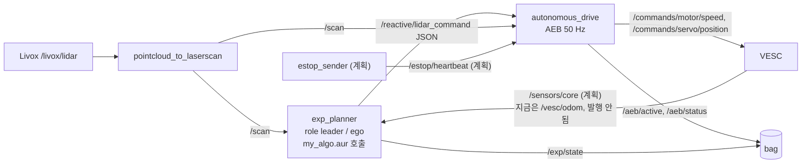
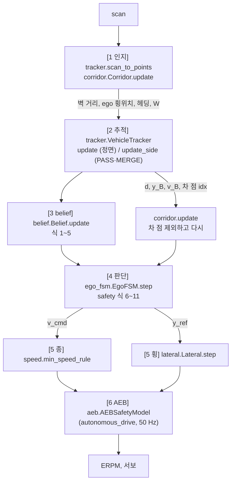
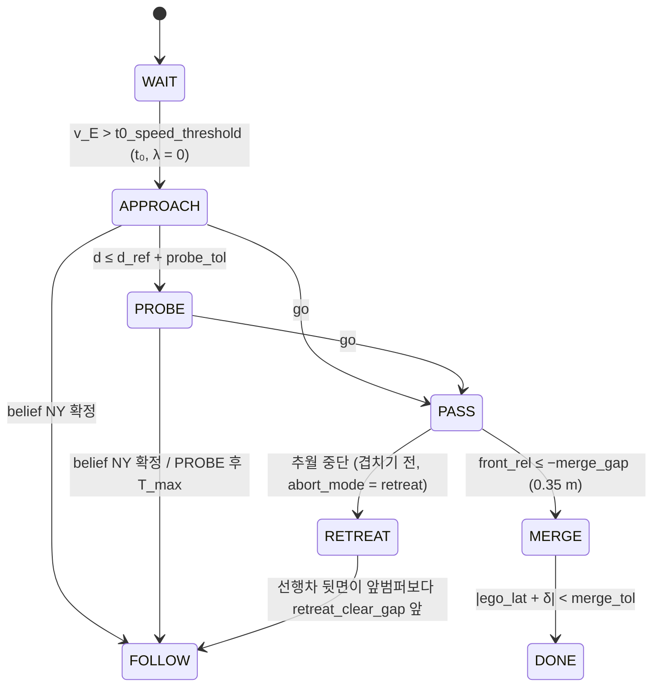

# 파이프라인

추월 실험(exp/aur-overtake)의 처리 흐름. 식 번호는 기획안과 같고, 바뀐 식은 `docs/PROGRESS.md`의 "기획안 변경"에 있다.
좌표: x 전방, y 왼쪽 양수, 통로 중심 y = 0. d = 앞범퍼 → 선행차 뒷면.

## 1. 노드와 토픽

실차 노드는 아직 일부만 있다. "(계획)"이 붙은 것은 지시서 3~7단계 계획이고 코드가 없다.

- `exp_planner`(`my_algo/exp_planner.py`)는 기본 주행의 `lidar_reactive_drive`를 대체한다 (같은 토픽·JSON 형식). `autonomous_drive`와 AEB 경로는 그대로 쓰고, `launch/exp_overtake.launch.py`가 `aeb_model:=geometric`으로 띄운다.
- leader 역할은 scan마다 `LeaderRunner.step`(`my_algo/aur/leader_runner.py`)을 부른다. 순서는 시뮬 `Sim._leader_frame`과 같고 `test_leader_runner_matches_sim_leader`가 명령 일치를 확인한다. ego 역할은 `EgoRunner.step`(`my_algo/aur/ego_runner.py`, 시뮬 `Car.perceive` + `Sim._ego_frame`과 같은 순서, `test_ego_runner_matches_sim_ego`).
- 두 차는 서로 다른 `ROS_DOMAIN_ID`를 쓴다 (통신 없음).
- 시뮬(`sim/aur_overtake/sim.py`)은 같은 순서를 한 프로세스에서 흉내 낸다: `Car.perceive` → `Sim._ego_frame` / `_leader_frame` (= exp_planner), `Car.control` (= autonomous_drive).

## 2. 모듈 파이프라인 (scan 한 프레임)

| 단계 | 파일 · 함수 | 입력 → 출력 |
|---|---|---|
| 1 인지 | `my_algo/aur/tracker.py` `scan_to_points` | LaserScan 필드 → 각도순 점 (라이다 좌표) |
| 1 인지 | `my_algo/aur/corridor.py` `Corridor.update` | 점, 차 점 idx, (선행차) 실측 W → 좌·우 벽 수직 거리, `ego_lateral`, `heading`, `W_est` |
| 2 추적 | `my_algo/aur/tracker.py` `VehicleTracker.update` | 점, 시각, v_E, ego 횡위치, W, 헤딩 → `Track(d, y_b, v_b, idx, width, y_l)`. `heading_comp`이면 점을 corridor 헤딩만큼 돌린 뒤 클러스터링. v_B는 α-β 필터, y_l은 왼쪽 옆면 직선 피팅 |
| 2 추적 | `VehicleTracker.update_side` | PASS·MERGE에서 직전 위치 근처 클러스터를 이어 추적 → `front_rel` (선행차 앞면 − ego 뒤범퍼) |
| 3 belief | `my_algo/aur/belief.py` `Belief.update` | z = y_B 변위, d, Δt → λ, `prob_yield()` |
| 4 판단 | `my_algo/aur/ego_fsm.py` `EgoFSM.step` | `Obs` → (v_cmd, y_ref, 상태, 이유) |
| 4 판단 | `my_algo/aur/safety.py` | 식 6 `d_safe`, 7 `h`, 8 `v_lim`, 9 `d_star`, 10 `probe_feasible`, 11 `pass_window`, `lateral_pass_ok`, `lane_offset` |
| 4 판단 | `my_algo/aur/leader_logic.py` `Leader.step` | (선행차) 후방 d_rear → (속도, 횡 목표) |
| 5 종 | `my_algo/aur/speed.py` `min_speed_rule` | 0 < v < v_min(0.867)이면 h ≥ ε이고 달리는 중일 때만 v_min, 아니면 0 |
| 5 횡 | `my_algo/aur/lateral.py` `Lateral.step` | ego_lateral, y_ref, 헤딩 → 조향 (오차 2(y_ref − y), 저역 필터, P + 헤딩 감쇠, deadband, rate limit). y_ref는 0.4 m/s 기울기 제한 |
| 6 AEB | `my_algo/baseline/aeb.py` `AEBSafetyModel.check_emergency_braking` | scan, 속도, 명령 → 긴급 정지 여부 |
| 공통 | `my_algo/aur/params.py` `AurParams`, `load_params` | `config/exp_common.yaml` (+ 시뮬 `scenario.yaml`의 `params`) |

## 3. 후행차 상태 기계 (`ego_fsm.py`)

| 조건 | 정의 |
|---|---|
| d_ref | a: `d_follow_a` 0.8, b: `d_follow_b` 1.5, c: `d_probe_c` 0.4, d: d*(v_B) (식 9) |
| belief 확정 | b = P(Y)가 처음 η(0.9) 이상 → Y, 처음 1−η 이하 → NY. 한 번 정하면 바뀌지 않는다 |
| 횡 여유 (`lateral_pass_ok`) | W/2 − y_B − w/2 ≥ w + 2c (선행차 왼쪽에 ego 폭 + 양쪽 여유) |
| go | a: PROBE 후 `T_wait_a`(3 s) 경과 + 횡 여유. b·c·d: belief Y 확정 + 횡 여유 |
| 추월 중단 | PASS, 앞뒤로 겹치기 전(d > 0): 선행차 y_B > (PASS 중 최소 y_B) + `y_yield_thr` 또는 횡 여유 없음 → RETREAT (`follow_reason = pass_abort`). 겹친 뒤(d ≤ 0)에는 중단하지 않고 차선 유지 + v_pass. 횡 여유 기준은 `lateral_ref` (center: y_B, left_edge: y_L) |
| RETREAT | 추월 차선(+δ) 유지, `retreat_speed_ratio` × v_B, 측면 추적 유지(선행차 점을 벽 계산에서 뺌). 선행차 뒷면이 앞범퍼보다 `retreat_clear_gap` 이상 앞서면 FOLLOW |
| front_rel | 선행차 앞면 x − ego 뒤범퍼 x (측면 추적, 안 보이면 마지막 v_B로 추측 항법) |

상태별 명령:

| 상태 | y_ref | v_cmd |
|---|---|---|
| WAIT·APPROACH·PROBE·FOLLOW | 0 | 방법별 추종: d는 min(v_pass, v_lim(d, v_B)) (식 8), c는 d_probe_c까지 v_pass 후 P 제어, a·b는 v_B + k_d(d − d_ref). 선행차가 안 보이면 v_B_nominal |
| PASS | +δ (δ = W/2 − w/2 − c) | 선행차와 중심 간격이 w + c가 되고 추월 차선에 도착(`lane_change_tol`)하기 전에는 추종 속도, 그 뒤 v_pass (이미 옆에 겹쳤으면 바로 v_pass) |
| RETREAT | +δ | `retreat_speed_ratio` × v_B |
| MERGE | −δ | `merge_v` 1.5 m/s (= v_pass, 들어가며 앞차와 간격을 벌린다. null이면 v_B_nominal) |
| DONE | −δ | v_B_nominal |

모든 상태에서 마지막에 `min_speed_rule`을 적용한다 (hold 히스테리시스: v_E > 0.35에서 켜짐, < 0.25에서 꺼짐).

선행차(`leader_logic.py`): t₀ 이후 Y는 d_rear ≤ d_y가 처음 되면 y_ref = −δ (유지), NY는 d_rear ≤ 1.0 m가 된 뒤 U[0.5, 2.0] s 후 급정지. d_y는 run_id seed로 U[0.6, 1.2]에서 뽑는다.

## 4. belief 갱신 (`belief.py`, `belief_model`)

π(d) = clip((d_y_max − d)/(d_y_max − d_y_min), 0, 1) (식 1). λ = ln[P(Y)/P(NY)], b = 1/(1 + e^(−λ)), |λ| ≤ 20. t₀에 λ = 0.

**original** (기획안 식 2~5): scan마다 z = y_B 변위를 독립 증거로 더한다.

    λ ← λ + ln[ π(d)·N(z; −v_lat·Δt, σ²) + (1 − π(d))·N(z; 0, σ²) ] − ln N(z; 0, σ²)

**survival** (기본, 기획안 변경): 누적 변위 s = y_B − y_B(t₀) 하나를 본다.

    s > −y_yield_thr (아직 양보 안 보임):  λ = ln(1 − π(d_lag))       d_lag = τ 전까지의 최소 d,  τ = t_react + y_yield_thr / v_lat
    s ≤ −y_yield_thr (흡수 상태):           λ = ln(π(d_min) / p_false_yield)

π(d) = 0인 거리(d ≥ d_y_max)에서는 둘 다 λ가 변하지 않는다. 근거와 실패 분석은 `docs/PROGRESS.md`.

## 5. 안전 거리 (`safety.py`)

t_d' = t_d + Δ (Δ = `scan_period`, 기획안 변경):

    d_safe(v_E, v_B) = v_E·t_d' + (v_E² − v_B²)/(2a) + m        (식 6)
    h = d − d_safe                                               (식 7)
    v_lim(d, v_B) = −a·t_d' + sqrt(a²t_d'² + 2a(d − m − ε) + v_B²)   (식 8)
    d*(v_B) = v_B·t_d' + m + ε                                   (식 9)

안전 판정 지표: 급정지 전 h_min, 급정지 후 정지 간격 ≥ m.

## 6. AEB 2층 구조 (`my_algo/baseline/aeb.py`)

| 층 | 상태 | 대상 | 판정 |
|---|---|---|---|
| (a) 독립 기하 AEB `model='geometric'` | 구현, 시뮬에서만 사용 (`autonomous_drive`에는 아직 model 파라미터가 없다) | scan 전체, 차 중심 ±(vehicle_half_width + path_margin) 띠 (실험값 ±0.16 m). `curved_band`면 조향 명령의 원호를 따라 휜다. 실험은 휜 띠의 조향을 ±0.3 rad로 자르고(`curve_max_steering`) 직선 띠에도 든 점만 본다(`band_intersect`): 옆에 나란한 벽 무시 | closest ≤ max(0.25 m, v·TTC). 속도를 모르면 0.25 m. tracker와 무관 |
| (b) relative AEB | 미구현 (5단계) | tracker 차량 클러스터 | 상대속도 기반 |
| `legacy` | 기본 주행 기본값, 변경 없음 | 띠 ±0.30 m | closest ≤ max(0.25, v²/(2·2.8) + 0.20, 0.55·v) |

AEB가 걸리면 `autonomous_drive`는 0 RPM, 조향은 planner 명령 그대로. 시뮬은 같은 순서를 `Car.control`에서 50 Hz로 돈다.
